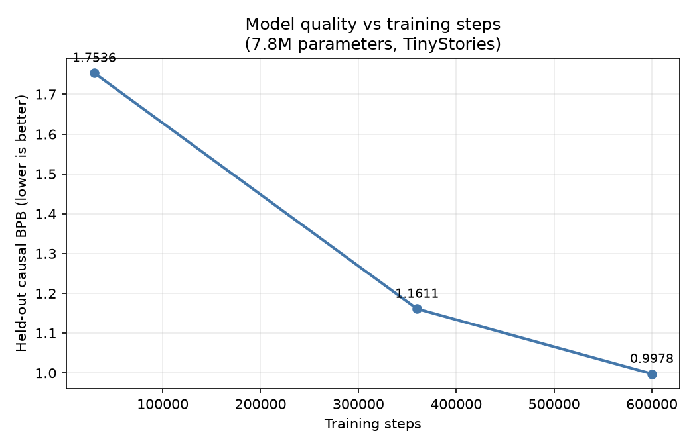
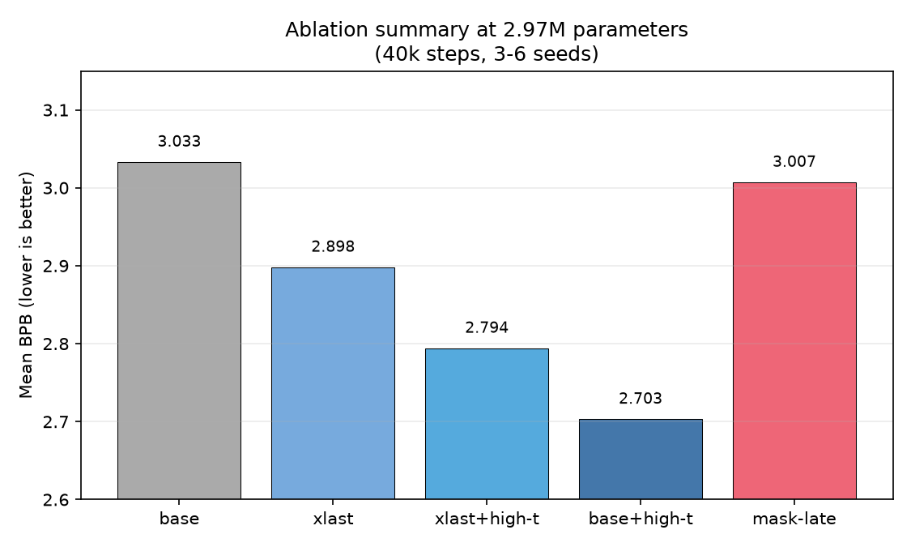
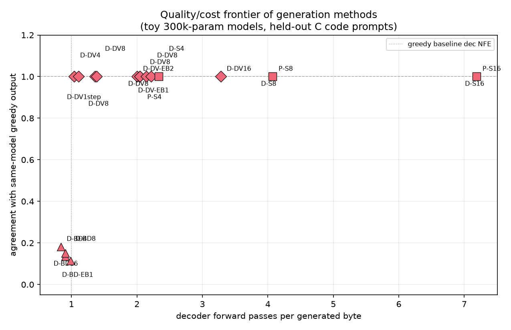
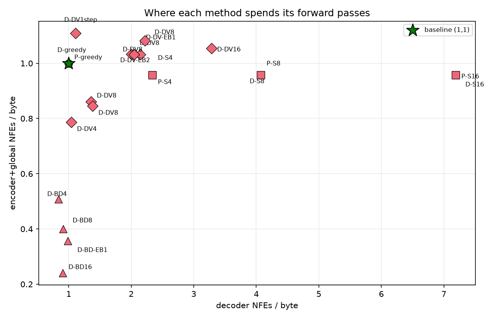
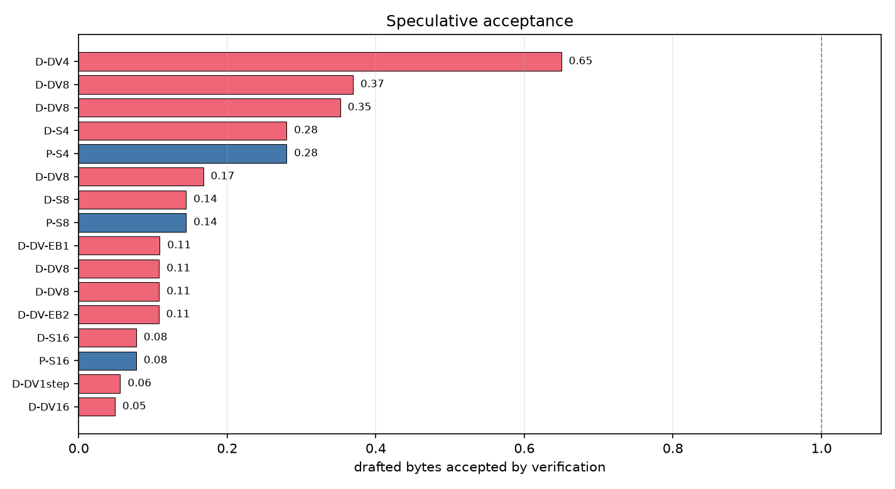
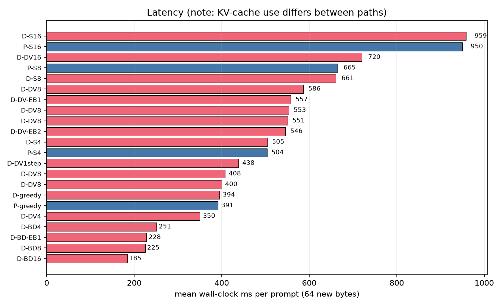
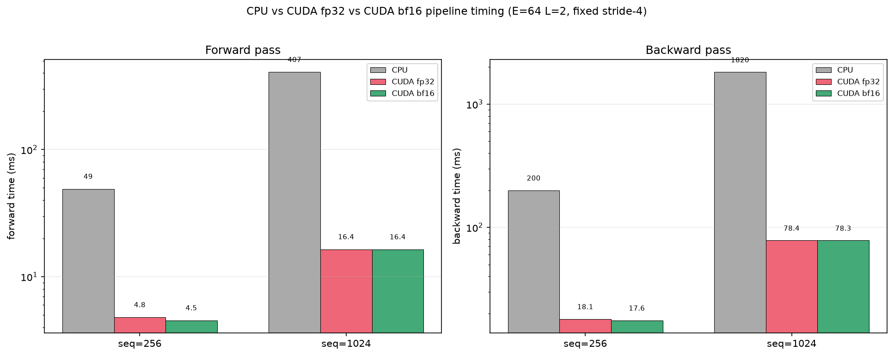

# Results

This page collects the main measured results for the 7.8M-parameter fBLT checkpoint. It is a
summary of [BENCHMARKS.md](BENCHMARKS.md) and [ABLATIONS.md](ABLATIONS.md), with links to the
raw measurement files and plotting script.

## Model quality

Held-out causal bits per byte on TinyStories:

| Checkpoint | Causal BPB |
|---|---:|
| 30k probe | 1.7536 |
| 360k | 1.1611 |
| 600k | **0.9978** |

Quality improves monotonically over 1.07 epochs; there is no observed overfitting.

## Model quality over training



## Inference methods

| Method | Cost | Output vs greedy |
|---|---|---|
| greedy | 1.00 enc / 1.00 dec NFE per byte | identical |
| BLT-S | fewer encoder, more decoder NFEs | identical |
| BLT-D | cheapest per byte | diverges |
| BLT-DV | near-greedy cost at high acceptance | identical |

## BLT-DV headline result

At the trained block size `B=4`, with the trained entropy LM:

| Metric | Value |
|---|---:|
| Draft acceptance | 65.0% |
| Agreement with greedy | 1.000 |
| Memory bandwidth vs greedy | 0.851x |
| Wall-clock vs greedy | 0.89x (350 ms vs 394 ms) |

At `B=8` and above, BLT-DV loses badly because those block cells were never supervised.

## Entropy vs fixed-stride patching

| Patching | BLT-DV B=4 acceptance | Agreement | BW vs greedy |
|---|---:|---:|---:|
| Entropy (matches training) | 65.0% | 1.000 | 0.851x |
| Fixed-stride-4 | 28.7% | 1.000 | 1.107x |

Entropy patching more than doubles acceptance and is required for the benchmarked result.

## Acceptance vs the Fast-BLT paper

| Config | Paper 3B (FR-EN) | fBLT 7.8M (TinyStories) |
|---|---:|---:|
| B=4 | 94.4% | 65.0% |
| B=8 | 86.3% | 10.8% |
| B=16 | 67.2% | 4.9% |

The `B=8` and `B=16` rows measure a train/inference mismatch, not a capability limit,
because the model was trained at `B=4`.

## CUDA performance

Relative to a single-threaded CPU baseline on the production config:

| Metric | Speedup |
|---|---:|
| Training | 76x |
| Generation | 34x |

Representative CUDA benchmark numbers: 6.4 TFLOP/s (42.4% MFU) for FP32 matmul and ~20 TFLOP/s
for BF16. CUDA runs are non-deterministic unless `--deterministic` is used.

## Ablation summary

At 2.97M parameters, 3-6 seeds, 40k steps:

| Setting | Finding |
|---|---|
| Step budget | 40k is the safe convergence floor |
| Mask warmup | 83% of steps is the validated default |
| Decoder depth | 2 layers is optimal; deeper does not help |
| Encoder depth | 2 layers; deeper is harmful |
| Cross-attention | `all` or `last` tie in quality; `last` is ~15% faster |
| High-t warmup | improves BPB by 0.33 |
| Mask-late | no benefit found |

## Ablation summary



## Graphs











## Reproducing

Raw measurements: `bench/results_tinystories_10m.jsonl` (44 rows, phase `6_infer`).

```bash
cmake --build build-cuda --target infer_bench
./build-cuda/infer_bench --backend cuda \
  --plain runs/tinystories_600k/tinystories_600k.fblt \
  --bltd runs/tinystories_600k/tinystories_600k.fblt \
  --entropy-lm runs/entropylm/entropy_lm.fblt \
  --heldout data/tinystories/heldout.bin \
  --embed 256 --hidden 512 --enc-layers 2 --glob-layers 6 --dec-layers 2 \
  --prompts 8 --new-bytes 64
```

Plots:

```bash
.venv/bin/python fblt/scripts/bench_plots.py \
  --results bench/results_tinystories_10m.jsonl --out graphs
```

Held-out quality:

```bash
./build-cuda/train_blt_d --corpus data/tinystories/train.bin \
  --load-weights runs/tinystories_600k/tinystories_600k.fblt --steps 0 \
  --embed 256 --hidden 512 --enc-layers 2 --glob-layers 6 --dec-layers 2 \
  --entropy-lm runs/entropylm/entropy_lm.fblt --entropy-patches \
  --eval-corpus data/tinystories/heldout.bin --eval-windows 200 --backend cuda
```

These are small-scale results. They demonstrate implementation behavior and trends, not
general claims about larger models.
